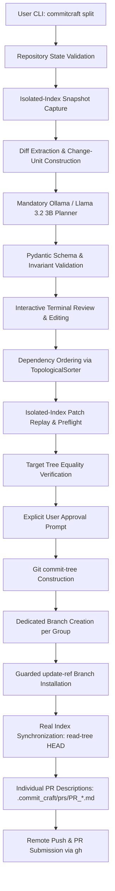

# CommitCraft

> Turn a messy Git working tree into logical, reviewable commits with local AI, user-controlled grouping, and automatic pull-request description generation.

[](https://opensource.org/licenses/MIT)
[](https://www.python.org/)
[](https://ollama.com/library/llama3.2)
[](tests/)

---

## 1. The Problem

Developers routinely modify several files and implement multiple unrelated changes while working on one task. Their working tree gradually accumulates bug fixes, refactors, tests, documentation edits, and formatting adjustments.

Eventually, they create **one monolithic commit** containing all those changes. Such commits are difficult to review, cherry-pick, bisect, and revert. While Git allows manually staging hunks via `git add -p`, it provides no semantic understanding of relationships between code, tests, and documentation.

## 2. The Solution

**CommitCraft** analyzes a repository's intended changes, extracts independently addressable change units (including splitting independent text hunks from the same file), and uses a local language model (**Llama 3.2 3B Instruct** running on **Ollama**) to propose logically related commit groups.

Developers inspect, reorder, and refine the proposal before CommitCraft constructs actual Git commits using isolated Git indexes, strictly proving **final-tree equality** before moving any branch pointer. Once verified, CommitCraft automatically creates dedicated Git branches and individual, editable Markdown pull-request descriptions for each group—following idiomatic open-source contribution practices. Finally, CommitCraft prompts to push the new branches to your remote and open pull requests against your base branch via the GitHub CLI (`gh`).

---

## 3. Architecture Pipeline



---

## 4. Engineering Principles & Invariants

1. **Mandatory Local AI Runtime**: Ollama running `llama3.2:3b` is a mandatory dependency for the core planning workflow. There is **no fallback planner**, no one-commit-per-file substitute, and no silent model substitution. If Ollama is unavailable, CommitCraft reports an actionable error and safely halts.
2. **Same-File Hunk Splitting**: Independent hunks from the same text file can be placed into separate commits (e.g. an authentication bug fix on line 2 and a formatting refactor on line 40).
3. **Mathematical Final-Tree Equality**: The final commit tree SHA must match the exact target snapshot tree SHA captured prior to planning.
4. **Pristine Real Index During Planning**: Isolated indexes (`GIT_INDEX_FILE`) are used for snapshot capture and patch replay. The user's actual `.git/index` and working files are never mutated during planning or preflight.
5. **No Blind Trust in LLMs**: Python code independently validates all unit assignments, unknown IDs, commit messages, and dependency graphs before any patch is replayed.

---

## 5. Prerequisites & System Requirements

CommitCraft requires the following core dependencies across all platforms:
- **Python**: `>= 3.11` (Python 3.12 recommended).
- **Git**: `>= 2.30` installed and accessible in system `PATH`.
- **Ollama**: Local AI runner with `llama3.2:3b` model downloaded.
- **GitHub CLI (`gh`)**: **Needed for automatically sending pull requests** to your remote repository. After installing `gh`, run `gh auth login` to authenticate. *(If `gh` is not installed, CommitCraft will still generate Git branches and save local PR Markdown descriptions in `.commit_craft/prs/`, but cannot open pull requests automatically on GitHub).*

### System Package Setup

#### Windows
Install prerequisites using [winget](https://learn.microsoft.com/en-us/windows/package-manager/winget/) or standalone installers:
```powershell
# Using winget in PowerShell:
winget install --id Git.Git -e --source winget
winget install --id Python.Python.3.12 -e --source winget
winget install --id GitHub.cli -e --source winget

# Authenticate GitHub CLI (needed for automatic PR sending)
gh auth login
```
> [!TIP]
> **WSL2 Recommendation**: CommitCraft runs smoothly on both native Windows (PowerShell / Command Prompt) and **Windows Subsystem for Linux (WSL2 / Ubuntu)**. If using WSL2, follow the Linux instructions below.

#### Linux
Install Git, Python 3.11+, and curl via your distribution's package manager:

- **Ubuntu / Debian**:
  ```bash
  sudo apt update
  sudo apt install -y git python3 python3-pip python3-venv curl gh
  gh auth login   # Needed for automatic PR sending
  ```
- **Fedora / RHEL**:
  ```bash
  sudo dnf install -y git python3 python3-pip curl gh
  gh auth login   # Needed for automatic PR sending
  ```
- **Arch Linux**:
  ```bash
  sudo pacman -S --noconfirm git python python-pip curl github-cli
  gh auth login   # Needed for automatic PR sending
  ```

#### macOS
Install prerequisites using [Homebrew](https://brew.sh/):
```bash
brew install git python@3.12 curl gh
gh auth login   # Needed for automatic PR sending
```

---

## 6. Ollama Setup

CommitCraft requires a local [Ollama](https://ollama.com) runtime with the mandatory `llama3.2:3b` model. There is no cloud API fallback. Follow the setup steps for your platform:

### Windows

1. **Install Ollama**:
   - Download the installer from [ollama.com/download/windows](https://ollama.com/download/windows), or install via `winget`:
     ```powershell
     winget install Ollama.Ollama
     ```
2. **Start the Service**:
   - Launch the Ollama application from the Start Menu or System Tray (runs in the background), or run in a terminal:
     ```powershell
     ollama serve
     ```
3. **Pull Model & Verify**:
   ```powershell
   ollama pull llama3.2:3b
   curl.exe -s http://localhost:11434/api/tags | Select-String llama3.2:3b
   ```

### Linux

1. **Install Ollama**:
   ```bash
   curl -fsSL https://ollama.com/install.sh | sh
   ```
2. **Start the Service**:
   - On systemd distributions, the service starts automatically:
     ```bash
     sudo systemctl status ollama
     # If stopped:
     sudo systemctl start ollama
     ```
   - Or start manually in a terminal:
     ```bash
     ollama serve
     ```
3. **Pull Model & Verify**:
   ```bash
   ollama pull llama3.2:3b
   curl -s http://localhost:11434/api/tags | grep llama3.2:3b
   ```

### macOS

1. **Install Ollama**:
   - Download the macOS app from [ollama.com/download/mac](https://ollama.com/download/mac), or install via Homebrew:
     ```bash
     brew install --cask ollama
     ```
2. **Start the Service**:
   - Open **Ollama** from Applications (it stays active in your menu bar), or start via terminal:
     ```bash
     ollama serve
     ```
3. **Pull Model & Verify**:
   ```bash
   ollama pull llama3.2:3b
   curl -s http://localhost:11434/api/tags | grep llama3.2:3b
   ```

---

## 7. Installation

Clone the CommitCraft repository:

```bash
git clone https://github.com/Team-NoName-Devs/CommitCraft.git
cd CommitCraft
```

Next, create a virtual environment and install the package using the instructions for your platform:

### Windows

#### Using `uv` (Recommended - PowerShell)
```powershell
# Install uv if needed: powershell -ExecutionPolicy ByPass -c "irm https://astral.sh/uv/install.ps1 | iex"
uv venv --python 3.12
.venv\Scripts\Activate.ps1
uv pip install -e ".[dev]"
```

#### Standard `venv` & `pip`
- **PowerShell**:
  ```powershell
  # If script execution is restricted, run: Set-ExecutionPolicy -ExecutionPolicy RemoteSigned -Scope CurrentUser
  python -m venv .venv
  .venv\Scripts\Activate.ps1
  pip install -e ".[dev]"
  ```
- **Command Prompt (`cmd.exe`)**:
  ```cmd
  python -m venv .venv
  .venv\Scripts\activate.bat
  pip install -e ".[dev]"
  ```

### Linux

#### Using `uv` (Recommended)
```bash
# Install uv if needed: curl -LsSf https://astral.sh/uv/install.sh | sh
uv venv --python 3.12
source .venv/bin/activate
uv pip install -e ".[dev]"
```

#### Standard `venv` & `pip`
```bash
python3 -m venv .venv
source .venv/bin/activate
pip install -e ".[dev]"
```

### macOS

#### Using `uv` (Recommended)
```bash
# Install uv if needed: brew install uv
uv venv --python 3.12
source .venv/bin/activate
uv pip install -e ".[dev]"
```

#### Standard `venv` & `pip`
```bash
python3 -m venv .venv
source .venv/bin/activate
pip install -e ".[dev]"
```

---

### Verify Installation (All Platforms)

Verify that the CLI executable is available in your PATH:

```bash
commitcraft --help
```

---

## 8. CLI Usage Guide

### 8.1 Diagnostic Inspection (`commitcraft inspect`)

Displays repository health, active branch, HEAD commit, modified files, and Ollama model status:

```bash
commitcraft inspect
```

*Example Output:*
```text
CommitCraft Diagnostic Inspection

✔ Repository Root: /home/user/project
✔ Active Branch:   main (refs/heads/main)
✔ HEAD Commit:     8fbf780e
          Working Tree Changes          
 Category   Files                       
 Staged     0: None                     
 Unstaged   2: app.py, math_utils.py    
 Untracked  1: tests/test_auth.py       

Ollama Runtime Status
✔ Endpoint: http://localhost:11434 (Connected)
✔ Required Model: llama3.2:3b (Available)
```

### 8.2 Interactive Splitting (`commitcraft split`)

Analyzes working changes, requests semantic grouping from Ollama, enables interactive review, verifies tree equality, and installs real Git commits:

```bash
# Interactive mode with rich proposal review
commitcraft split

# Dry-run mode: verify plan & preflight without altering Git history
commitcraft split --dry-run

# Split with unified diffs displayed alongside plan
commitcraft split --diff
```

#### Interactive Review Options & Shortcuts:
- **[1 / a] Approve & Execute**: Runs preflight, verifies tree equality, and prompts for explicit confirmation.
- **[2 / m] Move a unit**: Reassign a change unit between groups with auto-detected source group.
- **[3 / g] Merge groups**: Combine two groups into one cohesive commit.
- **[4 / s] Split group**: Carve out specific change units into a new commit group with auto-suggested IDs.
- **[5 / e] Edit message/title**: Revise Conventional Commit message or title with prefilled current defaults.
- **[6 / d] Edit dependencies**: Add or update prerequisite dependencies between groups.
- **[7 / r] Request fresh AI proposal**: Re-prompt Ollama for an alternative grouping.
- **[8 / v] View Diff**: Inspect syntax-highlighted unified diff of any unit, group, or all changes.
- **[0 / q] Abort**: Cancel the operation safely without touching Git state.

#### Automatic Branching & Pull Request Submission
Once approved, CommitCraft creates dedicated Git branches for each group and generates editable PR descriptions in `.commit_craft/prs/`. It then offers to push the branches and submit pull requests:
```text
Do you want to send pull request(s) to the base branch 'main'?
```
> [!NOTE]
> **GitHub CLI (`gh`) Needed**: To automatically push branches and open pull requests against your base branch via `gh pr create`, you must have **GitHub CLI (`gh`)** installed and authenticated (`gh auth login`). If `gh` is missing, CommitCraft safely leaves the branches in your local repository and preserves the full Markdown PR files in `.commit_craft/prs/` for manual submission.

### 8.3 Configuration (`commitcraft config`)

View or modify Ollama endpoint and timeout settings:

```bash
# View configuration
commitcraft config

# Update endpoint and read timeout
commitcraft config --url http://localhost:11434 --timeout 180.0
```

Environment variable overrides are also supported:
- `COMMITCRAFT_OLLAMA_URL`: Override Ollama base URL.
- `COMMITCRAFT_READ_TIMEOUT`: Override inference timeout (seconds).

### 8.4 Optional Advisory Git Hook (`commitcraft hook`)

Install an optional advisory pre-commit hook that alerts you when staging many files:

```bash
# Install hook
commitcraft hook install

# Remove hook (cleanly restores any previous backup)
commitcraft hook remove
```

---

## 9. Failure Handling & Recovery

- **Ollama Offline**: If Ollama is unreachable or `llama3.2:3b` is missing, CommitCraft provides the exact `ollama pull` command and cleanly halts.
- **Invalid Model Proposals**: If the model proposes missing units or invalid messages, CommitCraft feeds the exact validation errors back into Ollama for bounded correction attempts (up to 3 times). If exhausted, it aborts safely.
- **Concurrent Branch Movement**: If another process moves the branch during review, `git update-ref` aborts immediately to prevent overwriting newer history.
- **Index Synchronization Failure**: If the branch pointer updates but index synchronization fails, CommitCraft preserves full recovery state in `.git/COMMITCRAFT_RECOVERY.json` and provides the exact safe command to refresh your index:
  ```bash
  git read-tree HEAD
  ```

---

## 10. Running Automated Tests

All 128 unit, integration, and end-to-end tests run in complete isolation with mock transports:

```bash
pytest
```

---

## 11. License & AI Usage Disclosure

- **License**: Released under the [MIT License](LICENSE).
- **AI Usage**: Uses local **Llama 3.2 3B Instruct** via Ollama for semantic planning. No cloud APIs, proprietary models, or external services are used.
